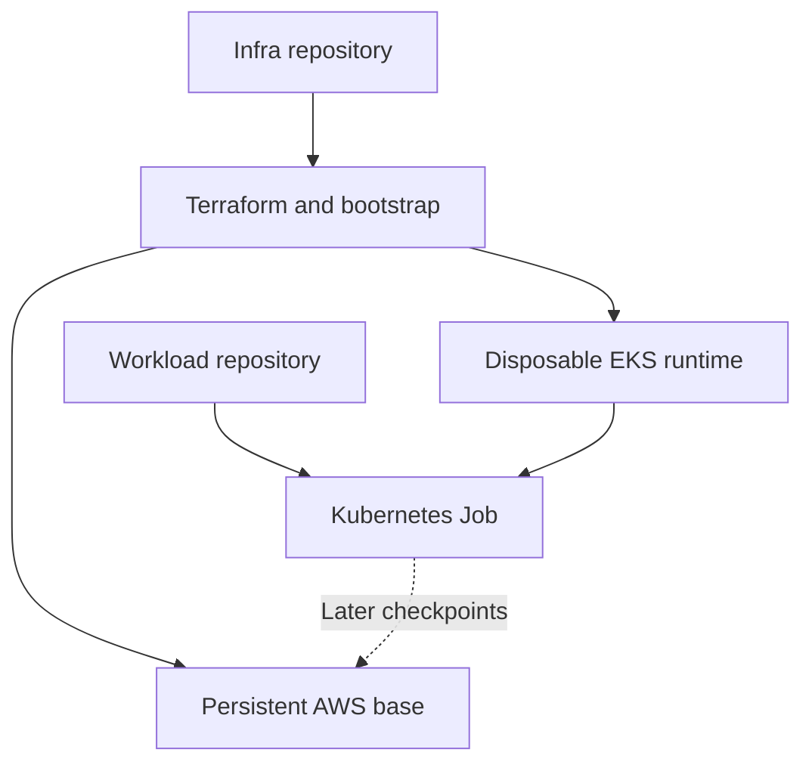
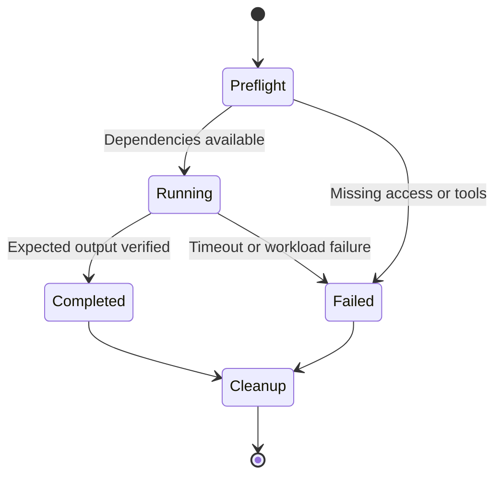

# Pre-production baseline

## Repository ownership (static architecture)

| Owner | Responsibility | Lifetime |
|---|---|---|
| infra_robot_sim | Terraform, AWS IAM/network/storage/EKS, cluster bootstrap, runtime start/stop | Persistent base + disposable runtime |
| robot_controller | New workload examples, Kubernetes workload configuration, future robot application | Versioned software; disposable Jobs |
| Operator | Existing EC2 runner/profile and Terraform state bucket | External; never removed by Hello World |
| S3 + DynamoDB | Application checkpoint payloads and committed progress | Retained across runtime loss |
| SSM | Resource discovery/configuration | Persistent; not Terraform state |
| Git | Desired configuration and exact software revisions | Persistent; not execution progress |

Existing controller code, Helm chart and Argo CD Application still live in infra_robot_sim.
This baseline does not move or duplicate that running controller. New workload ownership
starts in robot_controller. Migrate the existing controller in a separate reviewed change,
then change its Argo source once; never let two Applications own the same objects.
The existing Argo Application still tracks infra_robot_sim/dev.

## Runtime behavior (dynamic architecture)

1. Validate code locally with no cloud credentials.
2. Run infrastructure Hello World: isolated local Terraform lifecycle.
3. Optionally prove AWS identity, SSM discovery, and an S3 write/read round trip.
4. Start the existing dev EKS runtime only when cluster acceptance is needed.
5. Select an explicit kubeconfig context and dedicated namespace; create one CPU Job.
6. Capture its logs, require Complete and the expected marker, then delete only that Job.
7. Stop the runtime through the existing infra workflow when finished; deleting a Job
   does not remove EKS, NAT gateways, nodes, volumes, or their charges.

The Hello World Job has no durable progress and is rerun from the beginning after loss.
Later robot/training jobs need explicit checkpoint serialization, immutable manifests,
commit validation and fencing before claiming resume support. S3 does not replace etcd;
Git/Terraform reconstruct desired resources and application checkpoints restore progress.
For managed EKS this baseline does not provide an etcd backup/restore mechanism.
The physics/control loop belongs next to Isaac Sim. Cloud messaging is supervisory.

## Branches and promotion

- `feature/preproduction-hello-world`: reviewable implementation branch.
- `dev`: integration and manual development acceptance.
- `main`: accepted release baseline after dev evidence is reviewed.
- Later work: `feature/isaac-hello`, `feature/ur10-motion`, `feature/checkpoint-resume`,
  `feature/multipod-recovery`, each promoted independently through dev.

No push or PR should deploy infrastructure. Deployment uses the existing trusted
self-hosted runner and scoped role; validation can use hosted runners without AWS access.
Do not execute untrusted PR code on the administrator-backed runner.
Use PR review and required validation before promotion; branch protection is a recommended
repository setting, not something this change has enabled.
Record both repository commit SHAs, environment, image digest and run ID for acceptance.
A new GHCR tag must not replace a running experiment. Pin production images by digest.

## Acceptance gates

| Gate | Evidence | Does not prove |
|---|---|---|
| Local Terraform | Apply/output/destroy succeed | AWS permissions or networking |
| AWS round trip | STS identity, SSM bucket discovery, matching S3 object | EKS readiness |
| Kubernetes Hello World | Complete Job and HELLO_ROBOT_K8S log | GPU, Isaac Sim, checkpoint recovery |
| Isaac startup (next) | Pinned simulator starts/exits on qualified GPU | Robot motion |
| UR10 motion (next) | Loaded robot and measured joint movement | VM-loss recovery |
| Recovery (next) | Replacement worker resumes committed progress | Multi-worker consistency |

Real AWS and Kubernetes acceptance remains pending until run against configured infrastructure.
