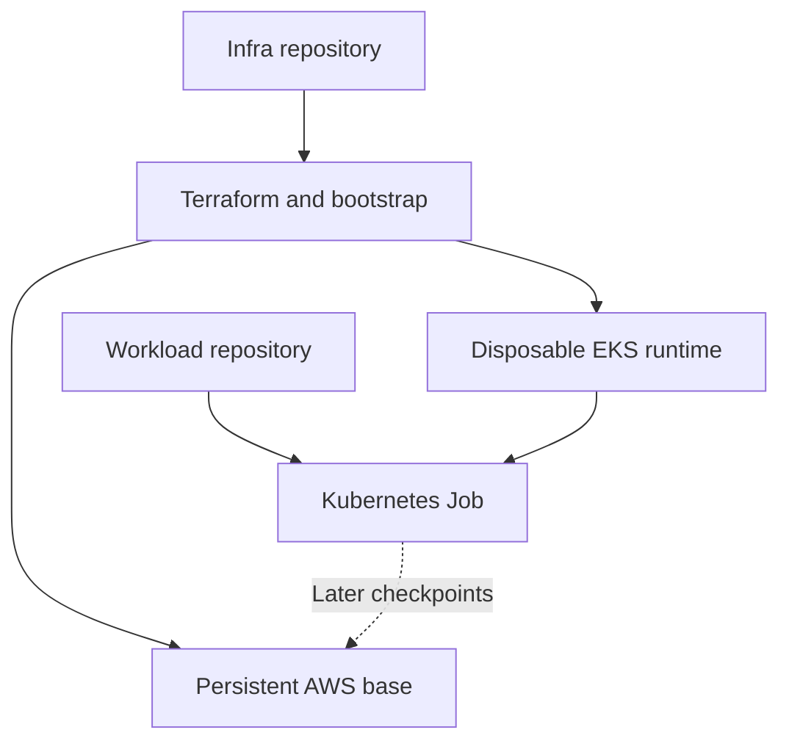
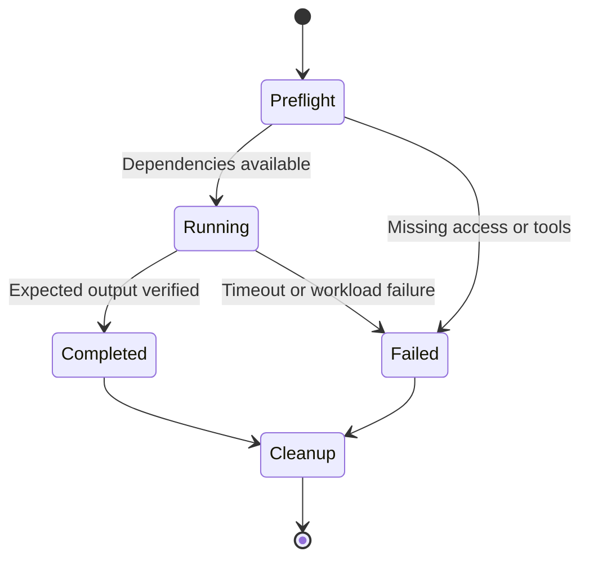

# Pre-production baseline

## Repository ownership (static architecture)

| Owner | Responsibility | Lifetime |
|---|---|---|
| infra_robot_sim | Terraform, AWS IAM/network/storage/EKS, cluster bootstrap, runtime start/stop | Persistent base + disposable runtime |
| robot_controller | Application code/images, Helm, workload GitOps/environments, releases/rollback, checkpoint migrations and recovery smoke tests | Versioned application lifecycle |
| Operator | Existing EC2 runner/profile and Terraform state bucket | External; never removed by Hello World |
| S3 + DynamoDB | Application checkpoint payloads and committed progress | Retained across runtime loss |
| SSM | Resource discovery/configuration | Persistent; not Terraform state |
| Git | Desired configuration and exact software revisions | Persistent; not execution progress |

Existing controller code, Helm chart and Argo CD Application still live in infra_robot_sim.
This baseline does not move or duplicate that running controller. New workload ownership
starts in robot_controller. Migrate the existing controller in a separate reviewed change,
then change its Argo source once; never let two Applications own the same objects.
The existing Argo Application still tracks infra_robot_sim/dev.

## Application ownership contract

robot_controller owns the complete application delivery and recovery lifecycle:

1. Application code and Dockerfiles.
2. The application Helm chart.
3. Workload Argo CD Applications and environment configuration.
4. Release and rollback procedures.
5. Checkpoint compatibility validation and migration code.
6. Release smoke tests that verify start, save, process replacement and resume.

infra_robot_sim owns Terraform, AWS resources and IAM, EKS and node lifecycle,
cluster-wide add-ons (including installation of Argo CD/Cilium), and publication of
the versioned SSM infrastructure contract. robot_controller consumes that contract.
Installing the Argo CD service belongs to infra; declaring the robot application's
desired version and Helm values belongs to robot_controller. An infra bootstrap
may reference the app entry point without becoming a second owner of app resources.

Application release records must pin the image digest, chart/configuration revision
and supported checkpoint schema versions. Rollback must check checkpoint compatibility:
reverting an image alone does not make newer checkpoint data readable by older code.
Migration must preserve the original checkpoint, produce a new versioned artifact and
validate it before committing the new resume pointer. Unsupported versions fail clearly.

The required recovery smoke test starts release A, saves a committed checkpoint,
terminates/replaces the worker, then proves resumed progress from that checkpoint.
For release B, verify supported migration/restore and the documented rollback path.
Logs or Kubernetes Job completion alone are not evidence of checkpoint recovery.

### Implementation status and migration boundary

This is the ownership target, not a claim that all six areas are implemented.
robot_controller now owns the CPU Hello World, SSM discovery tests, the checkpoint
protocol, the resume/indexed smoke workers and their images, the robot-sim chart and
the workload tests (unit, dynamic and kind e2e), plus SAST/SCA/image scanning.
The existing controller service, its Dockerfile, Helm chart and Argo Application
remain in infra_robot_sim until migrated with their build/promotion references and tests.
infra keeps the EKS destroy/recreate/resume test because it exercises runtime lifecycle;
it consumes the smoke image and Job template from robot_controller at a pinned ref.
Both repositories use the GHCR namespace in config/images.json.
Migrate application behavior; retain AWS infrastructure lifecycle handlers in infra.
Preserve a single Argo owner during cutover and avoid pruning live resources accidentally.
The existing stateless Hello World is not yet the required start/save/resume release test.

## Runtime behavior (dynamic architecture)

1. Validate code locally with no cloud credentials.
2. Run infrastructure Hello World: isolated local Terraform lifecycle.
3. Optionally prove AWS identity, SSM discovery, and an S3 write/read round trip.
4. Start the existing dev EKS runtime only when cluster acceptance is needed.
5. Select an explicit kubeconfig context and dedicated namespace; create one CPU Job.
6. Capture its logs, require Complete and the expected marker, then delete only that Job.
7. Stop the runtime through the existing infra workflow when finished; deleting a Job
   does not remove EKS, NAT gateways, nodes, volumes, or their charges.

The Hello World Job has no durable progress and is rerun from the beginning after loss.
Later robot/training jobs need explicit checkpoint serialization, immutable manifests,
commit validation and fencing before claiming resume support. S3 does not replace etcd;
Git/Terraform reconstruct desired resources and application checkpoints restore progress.
For managed EKS this baseline does not provide an etcd backup/restore mechanism.
The physics/control loop belongs next to Isaac Sim. Cloud messaging is supervisory.

## Branches and promotion

- `feature/preproduction-hello-world`: reviewable implementation branch.
- `dev`: integration and manual development acceptance.
- `main`: accepted release baseline after dev evidence is reviewed.
- Later work: `feature/isaac-hello`, `feature/ur10-motion`, `feature/checkpoint-resume`,
  `feature/multipod-recovery`, each promoted independently through dev.

No push or PR should deploy infrastructure. Deployment uses the existing trusted
self-hosted runner and scoped role; validation can use hosted runners without AWS access.
Do not execute untrusted PR code on the administrator-backed runner.
Use PR review and required validation before promotion; branch protection is a recommended
repository setting, not something this change has enabled.
Record both repository commit SHAs, environment, image digest and run ID for acceptance.
A new GHCR tag must not replace a running experiment. Pin production images by digest.

## Acceptance gates

| Gate | Evidence | Does not prove |
|---|---|---|
| Local Terraform | Apply/output/destroy succeed | AWS permissions or networking |
| AWS round trip | STS identity, SSM bucket discovery, matching S3 object | EKS readiness |
| Kubernetes Hello World | Complete Job and HELLO_ROBOT_K8S log | GPU, Isaac Sim, checkpoint recovery |
| Isaac startup (next) | Pinned simulator starts/exits on qualified GPU | Robot motion |
| UR10 motion (next) | Loaded robot and measured joint movement | VM-loss recovery |
| Recovery (next) | Replacement worker resumes committed progress | Multi-worker consistency |

Real AWS and Kubernetes acceptance remains pending until run against configured infrastructure.
