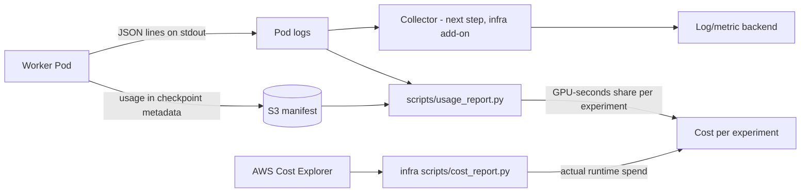

# Observability and cost analysis groundwork

This is the application half. infra_robot_sim owns the AWS half (tags, budget,
anomaly detection, Cost Explorer report). The two halves join through shared
labels and tags, so spend can be attributed down to an experiment, a shard and
a wasted (fenced) attempt.



## What exists now

### Structured telemetry (`workloads/telemetry.py`)

Every record is a single-line JSON object with `schema: robot-sim.telemetry/v1`, an
`event` name and a `resource` block. Resource keys follow OpenTelemetry semantic
conventions (`service.name`, `service.version`, `k8s.pod.name`, `k8s.node.name`,
`container.image.digest`, ...) plus `robot_sim.*` keys for the job, shard,
experiment, cost centre and capacity type. Any collector that can parse JSON
logs can map these to OTLP attributes without code changes.

Telemetry never makes network calls. A missing or slow collector cannot stall
a simulation step or a checkpoint commit.

Events: `resumed`/`shard_resumed`, `checkpoint`, `barrier_arrived`,
`barrier_released`, `suspended`, `completed`, `fenced`, `usage`.

### Usage records: the unit of cost attribution

Each worker attempt ends with one `usage` record:

```json
{"event":"usage","outcome":"completed","usage":{"wall_seconds":3600.0,"gpu_count":1,
 "gpu_seconds":3600.0,"steps":3500,"checkpoints":6,"checkpoint_bytes":120,
 "checkpoint_seconds":1.9,"barrier_wait_seconds":0.0},"resource":{...}}
```

`outcome: fenced` marks work that a newer attempt replaced, which is wasted spend
(for example, after Spot interruptions). The same cumulative counters are written
into every checkpoint manifest under `metadata.usage`. The manifest survives
in S3 after logs and the cluster are gone, so usage can be rebuilt after a
runtime destroy.

### Labels on every Job and Pod

| Label | Source | Purpose |
|---|---|---|
| `app.kubernetes.io/part-of: robot-sim` | chart / template | select all platform workloads |
| `robot-sim/job-id` | `job.id` | join to DynamoDB/S3 state |
| `robot-sim/experiment` | `cost.experiment` (defaults to job id) | group cost by experiment |
| `robot-sim/cost-center` | `cost.costCenter` | group by funding line |
| `robot-sim/capacity-type` | `scheduling.purchase` | spot vs on-demand rate |

The downward API also gives each Pod its `POD_NAME`, `POD_NAMESPACE`, `POD_UID`
and `NODE_NAME`. Use the node name to join a record to the node's instance type.

### Usage report (`scripts/usage_report.py`)

```bash
kubectl -n robot-platform logs -l app.kubernetes.io/part-of=robot-sim --tail=-1 \
  | python3 scripts/usage_report.py --format markdown
# optional estimate, with your own rates in USD per GPU-hour:
python3 scripts/usage_report.py logs.jsonl --rates rates.json
```

The report never assumes a price. Without `--rates` it reports GPU-hours,
attempts, wasted attempts, seconds per step and checkpoint/barrier overhead.
The kind e2e workflow publishes this report in its job summary on every run.

## How to get cost per experiment

1. Run infra's `scripts/cost_report.py` for the period. It gives actual AWS
   spend for `Project=robot-sim`, split by `Lifecycle` (base vs runtime) and
   by service.
2. Run `usage_report.py` over the same period's logs or manifests to get each
   experiment's share of GPU-seconds.
3. Experiment cost ≈ runtime GPU spend × experiment share. Add a share of the
   fixed runtime overhead (control plane, NAT, CPU nodes) by wall-clock share,
   if wanted.

For per-Pod cost without step 3, turn on **EKS split cost allocation data** in
AWS Billing preferences. It is an account setting, not Terraform. It can import
the `robot-sim/*` Pod labels above as cost allocation tags.

## Next steps (not built yet)

* Log/metric collector as a cluster add-on owned by infra (an OpenTelemetry
  Collector or Fluent Bit DaemonSet) that ships these JSON lines to
  CloudWatch Logs or S3, with retention set.
* NVIDIA DCGM exporter for GPU utilisation, so idle-but-billed GPU time shows up.
* Optional OTLP export from the worker, behind an environment flag, if traces
  or metrics are needed beyond logs.
* A dashboard over the usage records: GPU-hours by experiment, wasted-attempt
  ratio, checkpoint overhead, barrier wait.
